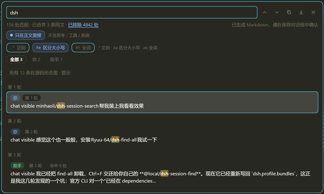

# dsh-session-find

[](https://www.npmjs.com/package/dsh-session-find)
[](LICENSE)
[](https://github.com/deepseek-ai/deepseek-harness)

**Find in session** for DeepSeek Harness: press `Ctrl+F` to search the current conversation, click a hit to jump to that message, with every match highlighted.

Client-only, zero dependencies, no network — all searching happens in the browser, nothing leaves your machine.

[中文](README.md) · [Changelog](CHANGELOG.md) · [Design notes](docs/DESIGN.md)



## Why

Harness conversations run for dozens of turns and interleave prose with tool calls and long JSON. The browser's built-in find only sees *rendered, visible* text: it misses collapsed steps, tool arguments and reasoning, and it cannot tell you who said what, or in which turn.

This plugin makes search conversation-native:

| Capability | What it does |
|---|---|
| Source labels | Every hit is tagged **you / assistant / reasoning / tool call / tool result / system**, and can be filtered by source |
| Turn grouping | Results are grouped under `turn N` headers, with a per-row turn chip |
| Same-text merging | Identical snippets (e.g. repeated tool output) collapse into one row marked `same text ×N` |
| Prose vs everything | Defaults to **prose only** (your messages + assistant replies); one click searches reasoning, tool payloads and system prompts too, showing how many hits were excluded |
| Regex / case / whole word | For tokens like `m0\d{3}`, `session-`, `D:\\DSH`; whole-word applies to ASCII words only |
| Highlight everything | All matches are highlighted in the conversation; the active hit gets an outline |
| Copy / export | Copy results as Markdown (turn + source + snippet) or save a `.md` file |
| Persisted state | Query, scope, regex flags and the last 12 queries live in localStorage (`↑`/`↓` in the input recalls history) |

## Compatibility

| Item | Value |
|---|---|
| DSH version | 0.2.x (developed and tested on `dsh-desktop-next 2.0.18-next` / `@deepseek-ai/dsh-base 0.2.1-alpha.2`) |
| Clients | Desktop window and web UI both work |
| Dependencies | None at runtime; injects into the `conversation.session.header.utilities` slot of `@deepseek-ai/dsh-client-ui-conversation` |
| Requires | the `dsh plugin` subcommand (bundled plugin CLI) |

If the slot does not exist (older 0.1.x) the panel never appears. It is mutually exclusive with another plugin that registers the same slot and grabs `Ctrl+F` — only one panel answers the shortcut at a time.

## Install

```sh
# npm (`--profile` defaults to the current profile)
dsh plugin add dsh-session-find
dsh plugin --profile desktop add dsh-session-find

# pin an exact version
dsh plugin add dsh-session-find@1.4.0

# or track main
dsh plugin add github:fomalhaut1998/dsh-session-find

# local development: link a working copy
dsh plugin add link:/path/to/dsh-session-find
```

Fully quit and restart DSH once: client bundles are assembled at host startup and are not hot-loaded. After that, editing `client.js` only needs a page reload (Ctrl+R in the desktop window, Ctrl+Shift+R in the browser).

Remove: `dsh plugin remove dsh-session-find` (also accepts `--profile`).

## Shortcuts

| Key | Action |
|---|---|
| `Ctrl+F` | Open / close the panel |
| `Enter` / `Shift+Enter` | Next / previous hit |
| `Ctrl+G` / `F3` (with `Shift` to reverse) | Same, for editor habits |
| `↑` / `↓` | In the input: recall query history. In the list (input not focused): move the selection |
| `Esc` | Close the panel (highlights stay until the next search) |
| `Tab` / click | Move between the prose toggle, the regex / case / whole-word toggles and the source filter |

## An example

```
Ctrl+F → type dsh → header: 198 matches · 3 duplicates merged · 6347 excluded
         click "Aa"        → 156 matches (case-sensitive only)
         click "prose only" → only what you and the assistant said; tool JSON hits are excluded
```

Counts are literal: **matches** is every occurrence (duplicates included), **listed rows** is the de-duplicated set you can click.

## Export format

```markdown
# Search: tool

> Message text only · 2026/10/18 14:56:48
> 45 matches · 1 rows listed

### Turn 4

- **You** — …g 我自己的这个插件，有以下地方可以优化一下： 1、横向的长度可以长一点…
```

The heading, scope line, turn headers and source labels follow the UI language (English or Chinese). Paste the block straight into notes, an issue or a doc. On the desktop the export goes through the native Save dialog; in the browser it is a normal download.

## How it works

- Reads the conversation store's canonical `order` node by node (`nodeStore.get(key)`) instead of walking the DOM, so collapsed steps and unrendered tool payloads are searchable.
- Projects each node into source-tagged fragments; prose mode concatenates only `user` + `assistant` text, and "excluded N" is the difference to the full hit count.
- Jumping expands the target turn/step first, then converges with a turn-level binary search plus a single-direction `scrollTop`, falling back to content matching when keys disagree.
- Highlighting uses the CSS Custom Highlight API (`::highlight(dsh-session-find)` and `::highlight(dsh-session-find-all)`), so the DOM is never mutated and React rendering is untouched.
- `index.js` `apply()` is empty: no IPC, no background index, no requests.
- **Privacy**: localStorage holds only the query, scope, the three toggles and the last 12 queries (`dsh-session-find:*`). No conversation content, no telemetry — the devtools Network panel stays quiet.

More on the trade-offs, the jump algorithm and the measured regressions: [docs/DESIGN.md](docs/DESIGN.md).

## Limitations

| Limit | Why |
|---|---|
| Only **loaded** history | The session is paged in on demand; unloaded messages are not in the store |
| Result list capped at 300 rows | A scrolling panel beyond that is not usable; the match count itself is uncapped |
| Whole-word is ASCII-only | Chinese has no word boundaries, so the option only applies to pure ASCII queries |
| No cross-session search | That needs a host-side index; out of scope for v1 |
| Hits inside collapsed steps | Jump to the enclosing turn, with a note that the exact node is collapsed |

## Troubleshooting

| Symptom | Cause and fix |
|---|---|
| `Ctrl+F` does nothing after install | DSH was not fully restarted (bundles are assembled at host startup). Make sure no tray/background process survives |
| Panel opens but early messages are missing | Only loaded history is searchable; scroll up to page older messages into the store |
| Two panels fight, or only one responds | Another plugin registers the same slot / grabs `Ctrl+F`; disable one of them |
| `F3` does nothing on the desktop | The host swallows that key first; use `Ctrl+G`, which follows the same path (verified) |
| Edited `client.js` but the UI did not change | Client artifacts are cached: reload the page. Only structural changes (`cordis.patch.yml` / `package.json`) need a full restart |
| Preferences reset after upgrading | Since 1.4.0 the localStorage prefix changed from `@local/dsh-session-find:` to `dsh-session-find:`; old keys are not migrated (defaults back to prose-only) |

## Development

```
client.js          client bundle: hand-written ModuleLoader format, no build step
index.js           host half: empty apply (registers no tools or services)
cordis.patch.yml   bundle entry, id and name are both dsh-session-find
package.json       dsh.bundle.patch points at that patch, dsh.client.inject declares the slot dependency
docs/DESIGN.md     design notes and trade-offs
```

- **No build**: edit `client.js` and reload the page. Only `cordis.patch.yml` / `package.json` changes require a full restart.
- **The module id must equal the package name**: `__ModuleLoader__.load({ id: "dsh-session-find", ... })`; the host registers bundles by name, and a mismatch leaves the entry unresolved.
- **Syntax check** (fastest fallback without opening the UI):

  ```sh
  node -e "new (require('vm').Script)(require('fs').readFileSync('client.js','utf8'))"
  ```

- **Manual test pass**: open the panel → toggle prose/full → toggle regex · case · whole word → click a hit to jump → copy and export → reload and confirm the query and toggles survived.

## License

MIT
